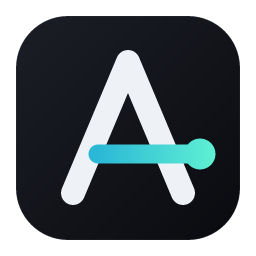
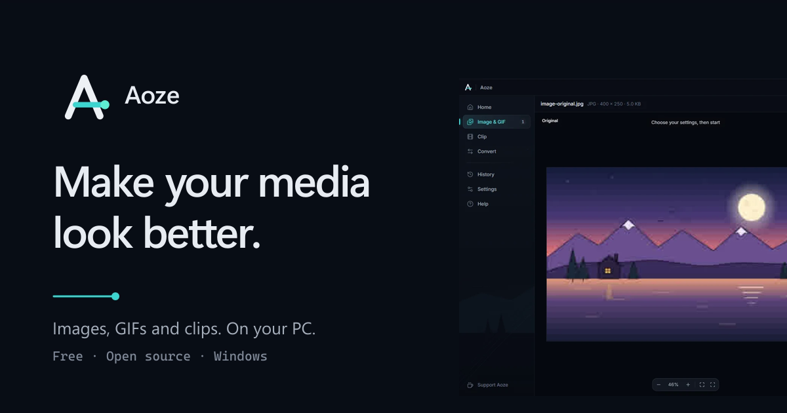
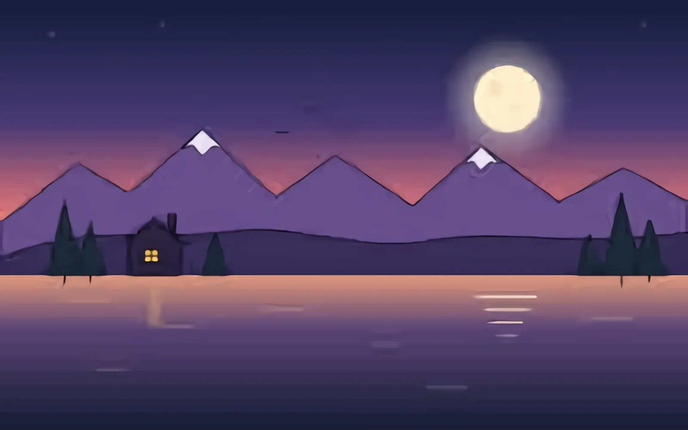

<div align="center">



# Aoze

**Make your images, GIFs and clips look better. On your PC, in one click.**

[](https://github.com/lololyeye/aoze/releases/latest)
[](https://github.com/lololyeye/aoze/releases)
[](#-requirements)
[](LICENSE)

[**⬇ Download for Windows**](https://github.com/lololyeye/aoze/releases/latest) · [Website](https://aoze.fr) · [Support on Ko-fi ☕](https://ko-fi.com/aoze_support)

<br />



</div>

<br />

Aoze is a free Windows app that **upscales, cleans up, smooths and compresses** your images, GIFs and short videos. Drop a file, pick a size or a preset, click once. Aoze takes care of FFmpeg, codecs, AI models and your graphics card for you.

> **Nothing leaves your computer.** No account, no upload, no telemetry, no API key.
> The only network request is the update check at launch, and you can turn it off.

<br />

## ✨ Why Aoze

|  |  |
|---|---|
| 🖱️ **One click** | Drop a file, choose a preset, done. Every option has a **?** that explains it in plain words, and a guided tutorial shows you around on the first launch. |
| 🔒 **100 % local** | Your files are processed on your own PC, with your own graphics card. Works offline. |
| ⚡ **Uses your GPU** | Any Vulkan GPU (NVIDIA, AMD, Intel, integrated). No GPU? It falls back to the CPU automatically. |
| 🧭 **Honest** | Real progress, real sizes, real frame rates. No fake "quality %", and it tells you when something could not be done. |

<br />

## 🖼️ Before / after

<table>
  <tr>
    <td align="center"><br /><sub><b>Original</b> · 400 × 250</sub></td>
    <td align="center"><br /><sub><b>Aoze, 4×</b> · 1600 × 1000, noise removed</sub></td>
  </tr>
</table>

More examples, including Smooth Motion from 24 to 60 FPS, are on the [website](https://aoze.fr).

<br />

## 🚀 Get started in 3 steps

1. **Download** `Aoze_<version>_x64-setup.exe` from the [latest release](https://github.com/lololyeye/aoze/releases/latest) and run it.
   It installs for your user only (no admin rights) and includes everything: FFmpeg, the AI engines and their models.
2. **Open Aoze** and drop an image, a GIF or a clip anywhere in the window.
3. **Pick a preset** (or adjust the options) and click **Process**. The result opens next to your original.

> [!NOTE]
> The installer is not code-signed yet, so Windows SmartScreen may say *"Windows protected your PC"*.
> Click **More info**, then **Run anyway**. Each release lists the SHA-256 of the installer so you can check it.

Installed copies **update themselves**: when a new version is out, Aoze shows what changed and installs it in one click. Every update is checked first (official GitHub release only, Aoze's signature, SHA-256).

<br />

## 🎨 What it can do

### Images & GIFs

- **Enlarge** 1.6×, 2×, 4× (8× for images) with **waifu2x**, the reference for anime and illustrations, or a photo model for real-life pictures.
- **Remove noise and JPEG artefacts** (5 levels), or **compress** with a target: *Best*, *Balanced*, *Smaller*, or a **maximum file size** (in KB or MB) that Aoze reaches for you.
- **GIFs keep their transparency and frame timing**. Change their frame rate, add motion blur, or compress them under a size limit.
- **Discord sizes** in one click: profile picture, profile banner, server banner (right size, right ratio, under the upload cap).
- Output as **PNG, JPEG or WebP**. The size shown before compressing is a real encode, so it is exact.

### Clips

| | |
|---|---|
| 🌊 **Smooth Motion** | Real in-between frames with **RIFE** on your GPU: 24 FPS becomes a fluid 60 or 120 FPS. On anime, drawings held for 2–3 frames are interpolated too, so it moves on every frame instead of stop-and-go. Scene cuts are never blended. |
| 💨 **Motion blur** | A virtual camera shutter with an intensity slider. It follows the speed: fast parts get a longer smear. |
| ⏱️ **Speed** | Slow motion, fast, a ready-made ramp or your own curve. Changes are eased, slow parts get new frames, and the sound follows at the same pitch. |
| 📐 **Smart Reframe** | 16:9, 9:16, 1:1 or 4:5. The frame follows what matters (the moving subject, or the cursor and panels of a screen recording) like a camera operator would, instead of cutting the centre. Black bars are removed. |
| ✨ **Sharpen or clean up** | A fast *Sharpen*, or a full AI *Clean-up* (Real-ESRGAN for anime, waifu2x for live action) with flicker reduction. |
| 🎨 **Color** | Keeps HDR, converts HDR to SDR properly, or rebuilds SDR clips as HDR10. Six built-in looks, your own `.cube` LUTs, plus exposure, contrast, saturation and glow. |
| 🥁 **Beat Sync** | A zoom punch or a short shake on the beat of the clip's own music. No clear beat? Nothing is added, and Aoze tells you. |

**The preview is made for comparing.** Your clip plays as soon as it is imported and keeps playing while it is processed. When the result is ready it joins at the same moment: drag the bar to compare **before / after** in sync, or switch to side by side. **←** and **→** step one frame at a time.

**Presets** set everything for a common use: *Anime Smooth*, *TikTok Smooth*, *Cinematic*, *Clean*. Hover one to see exactly what it turns on.

### Convert

Change a file's format without thinking about it: **video → GIF**, **GIF → video**, **images → GIF** and **GIF → separate frames**, with the size, frame rate, quality and file-size limit you want.

### Made to be easy

- 🧭 **A guided tour** on the first launch, in English or French: the element being explained is highlighted with an arrow and a short note, and a voice announces each chapter. Skip it anytime, replay it from *Help*.
- ❔ **A "?" next to every option**, and a *Help* page that answers common questions.
- 📋 **A real queue**: live progress and time left, pause, cancel (no half-written file), retry, and a full **history** of what you processed.
- 🖥️ **Adapts to your PC**: on a modest graphics card, Aoze picks lighter settings, smaller GPU work units and a lighter preview, so the rest of your computer stays smooth. If the GPU runs out of memory, it retries with something lighter instead of failing.
- 🌗 Dark and light themes, English and French.

<br />

## 🔒 Privacy

- Every file is processed **on your computer**. Nothing is uploaded, ever.
- No account, no analytics, no telemetry.
- The only network request is the **update check** at launch (the version file of this repository's releases). Turn it off in *Settings → Updates*.

<br />

## 💻 Requirements

| | Minimum | Recommended |
|---|---|---|
| **System** | Windows 10 or 11, 64-bit | Windows 11 |
| **Graphics** | none (CPU fallback, much slower) | any Vulkan GPU with 4 GB+ of video memory |
| **Memory** | — | 8 GB or more for 4K clips |
| **Disk** | about 300 MB for the app | plus room for your results |

Video encoding uses your GPU when it can (NVIDIA NVENC, AMD AMF, Intel Quick Sync) and the CPU otherwise.

<br />

## ❓ FAQ & troubleshooting

<details>
<summary><b>Windows says "Windows protected your PC"</b></summary>

The installer is not code-signed yet. Click **More info**, then **Run anyway**. You can compare the installer's SHA-256 with the one listed on the release page.
</details>

<details>
<summary><b>"No Vulkan GPU — using CPU"</b></summary>

Update your graphics driver, then open *Diagnostics* (click the GPU status at the top right) and choose **Re-detect GPU**. Without a GPU, everything still works on the CPU, just slower.
</details>

<details>
<summary><b>"The GPU stopped responding" or "ran out of memory"</b></summary>

Close games or other GPU-heavy apps. In the options, *Advanced → Tile size* 64–128 makes the GPU work in smaller pieces. Aoze already retries once with smaller tiles on its own.
</details>

<details>
<summary><b>"Video tools are missing"</b></summary>

An antivirus may have quarantined `ffmpeg.exe`. Restore it, or reinstall Aoze.
</details>

<details>
<summary><b>A clip doesn't show in the preview</b></summary>

For formats the preview can't play directly (HEVC, 10-bit, MKV, AVI…) or very large clips, Aoze makes a light preview copy, which takes a few seconds. Processing always uses your original file.
</details>

<details>
<summary><b>Why is Smooth Motion or Clean-up slow?</b></summary>

They run AI models on every frame. Expect minutes for long or 4K clips. *Sharpen* and *Smooth Motion → Fast* are the quick options.
</details>

<details>
<summary><b>Where are my settings and files?</b></summary>

Settings, history and measured speeds: `%APPDATA%\app.aoze`. Cache and previews: `%LOCALAPPDATA%\app.aoze`. Logs: *Diagnostics → Open logs folder*. Results are saved next to your originals by default (change it in *Settings*).
</details>

<details>
<summary><b>Something else went wrong</b></summary>

Open *Diagnostics* and click **Copy diagnostic**, then [open an issue](https://github.com/lololyeye/aoze/issues) with it.
</details>

<br />

## 🛠️ For developers

Aoze is built with **Tauri 2** (Rust) and **React 19** (TypeScript). The heavy lifting is done by bundled, unmodified command-line engines driven from Rust.

<details>
<summary><b>Build from source</b></summary>

Requirements: Windows 10/11 x64, Node.js 20+, Rust (MSVC toolchain), Visual Studio Build Tools (C++).

```bash
npm install
```

```bash
npm run fetch-engine
```

```bash
npm run dev
```

`fetch-engine` downloads waifu2x-ncnn-vulkan, FFmpeg, rife-ncnn-vulkan and realesrgan-ncnn-vulkan at pinned versions and checks their SHA-256.

```bash
npm test
```

runs Vitest, then `cargo test`: unit tests plus integration tests that use the real engines and FFmpeg (images, compression, GIFs, clips, cancellation, invalid files…).

```bash
npm run build
```

produces the per-user NSIS installer in `src-tauri/target/release/bundle/nsis/`. Public releases are made with `npm run release` (see [RELEASE.md](RELEASE.md)).
</details>

<details>
<summary><b>How it fits together</b></summary>

```
React UI  (Home · Image & GIF · Clip · Convert · History · Settings · Help)
   ↓  Zustand stores · services/api.ts (the only place calling Tauri)
Rust commands
   ↓
core / queue        one GPU worker, real progress events
   ├─ pipeline.rs   still images: engine → resize → encode (compress.rs: size-limit search)
   ├─ anim.rs       GIFs and clips: analysis → frames → engines (by blocks) → FFmpeg → encode
   │    ├─ smooth.rs    RIFE (Smooth Motion, motion blur)
   │    ├─ timemap.rs   speed curves and held drawings
   │    ├─ reframe.rs   Smart Reframe
   │    ├─ beat.rs      Beat Sync
   │    └─ color.rs     HDR, looks and LUTs (one 3D LUT per clip)
   └─ convert.rs    video ↔ GIF, images → GIF, GIF → frames
engine/  →  waifu2x-ncnn-vulkan · realesrgan-ncnn-vulkan · rife-ncnn-vulkan  →  Vulkan
media.rs →  ffprobe / ffmpeg, hardware encoder detection
```

| Folder | What's inside |
|---|---|
| `src/app/` | shell: titlebar, sidebar, splash, theme, global events |
| `src/features/` | home, workspace, convert, upscale (controls, stage, result), viewer, queue, settings, history, help, tour, update |
| `src/components/ui/` | Button, Segmented, Select, Slider, Toggle, Tooltip, HelpTip, Sheet… |
| `src-tauri/src/` | core, queue, tuning, pipeline, anim, smooth, timemap, reframe, beat, color, looks, convert, compress, media, engine, updates… |
| `src-tauri/tests/` | integration tests with the real engines and FFmpeg |
| `website/` | the [website](https://aoze.fr) (Astro) |

The video engine, its measurements and the choices behind it are documented in [docs/VIDEO_ENGINE.md](docs/VIDEO_ENGINE.md).
</details>

<br />

## 🙏 Credits & licences

Aoze's own code is released under the [MIT License](LICENSE). It is built on the work of others, whose licences ship with the app and are listed in [THIRD_PARTY_NOTICES.md](THIRD_PARTY_NOTICES.md):

- **waifu2x** by nagadomi, run by **[waifu2x-ncnn-vulkan](https://github.com/nihui/waifu2x-ncnn-vulkan)** by nihui (MIT): image enlargement and noise reduction.
- **[RIFE](https://github.com/hzwer/Practical-RIFE)** by hzwer (MIT), run by **[rife-ncnn-vulkan](https://github.com/TNTwise/rife-ncnn-vulkan)** (TNTwise's fork, MIT): Smooth Motion and motion blur.
- **[Real-ESRGAN](https://github.com/xinntao/Real-ESRGAN)** by xinntao (BSD-3-Clause) and realesrgan-ncnn-vulkan (MIT): anime clip clean-up.
- **[FFmpeg](https://ffmpeg.org)** (GPL build by [BtbN](https://github.com/BtbN/FFmpeg-Builds)), with Rubber Band and libplacebo: all GIF and video processing.
- Welcome voice and tutorial announcements made with **[Piper](https://github.com/rhasspy/piper)** (en_US *hfc_female* voice, CC BY 4.0).
- Tauri 2, React 19, TypeScript, Zustand, Radix UI, Motion and Lucide.

<br />

<details>
<summary><b>🇫🇷 En français</b></summary>

<br />

**Aoze** est une application Windows gratuite qui **agrandit, nettoie, fluidifie et compresse** vos images, GIF et courtes vidéos, **directement sur votre PC**. Rien n'est envoyé sur internet : pas de compte, pas d'envoi de fichiers, pas de télémétrie.

- **Images & GIF** : agrandissement jusqu'à 8× (waifu2x), réduction du bruit, compression avec une taille maximale, formats Discord en un clic.
- **Clips** : Smooth Motion (vraies images intermédiaires, 60 ou 120 FPS), flou de mouvement, vitesse et ralentis, recadrage intelligent pour TikTok (9:16), couleurs HDR et LUT, Beat Sync, et une comparaison Avant / Après synchronisée.
- **Convertir** : vidéo → GIF, GIF → vidéo, images → GIF, GIF → images.
- **Simple** : un tutoriel guidé au premier lancement, un « ? » à côté de chaque option, des préréglages, et des mises à jour automatiques.

**Installation** : téléchargez `Aoze_<version>_x64-setup.exe` depuis la [dernière version](https://github.com/lololyeye/aoze/releases/latest) et lancez-le. Si Windows affiche « Windows a protégé votre ordinateur », cliquez sur **Informations complémentaires** puis **Exécuter quand même** (l'installeur n'est pas encore signé). L'application est entièrement en français.

</details>

<br />

<div align="center">

<sub>Made for aoxy, by zero · <a href="https://ko-fi.com/aoze_support">Support Aoze on Ko-fi</a> ☕</sub>

</div>
